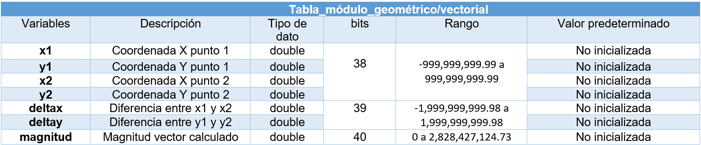
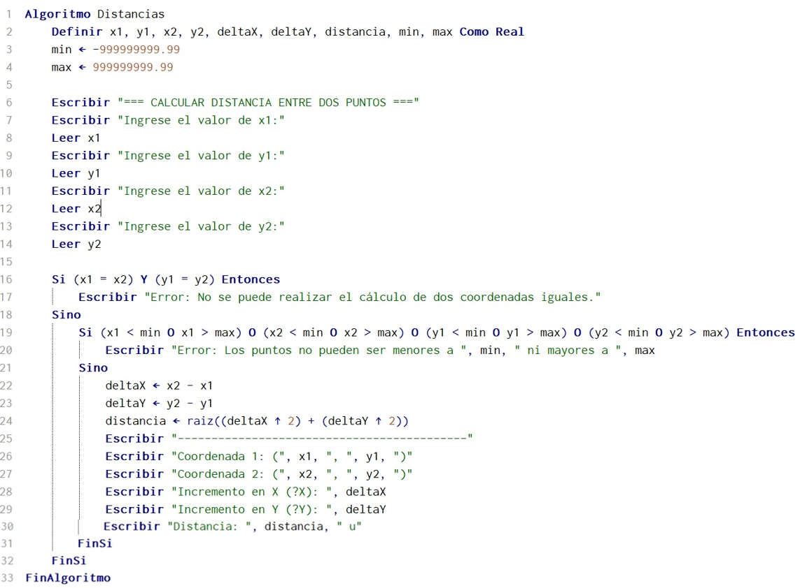
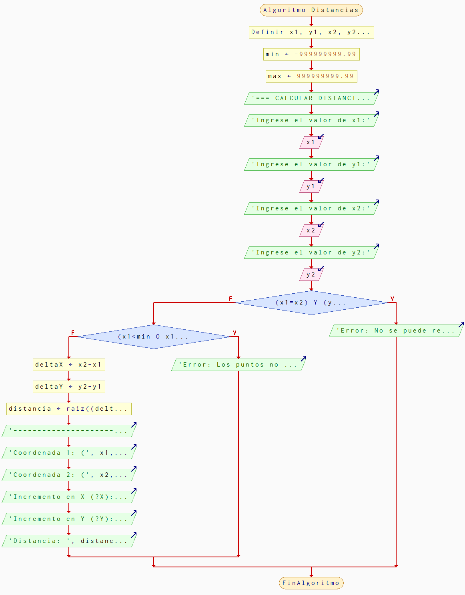

### Módulo geométrico-vectorial: incrementos y magnitud
ENUNCIADO:

En gráficos por computadora y modelado de redes, los desplazamientos de elementos en pantalla y la distancia entre dos nodos se representan con coordenadas en un plano cartesiano 2D. Se debe determinar la variación de posición (incrementos) y la magnitud del vector resultante entre dos puntos P1(x1, y1) y P2(x2, y2).

### 1. Tabla detallada de entradas, procesos y salidas

| **Entradas** | **Procesos (detallados)** | **Salidas** |
|---|---|---|
| X1, Y1, X2, Y2 ingresados por el usuario. | **1. Captura de datos:** Se reciben las cuatro coordenadas mediante los campos x1T, Y1T, X2T y Y2T. | Valores de las cuatro coordenadas capturadas. |
| Coordenadas ingresadas. | **2. Validación de campos:** Se comprueba mediante getText().trim().isEmpty() que ninguno de los cuatro campos esté vacío. Si falta algún dato, se asigna a mensaje el texto de error y se llama al método limpiar(). | Mensaje: "Complete toda la información para continuar". |
| X1, Y1, X2, Y2. | **3. Validación de coordenadas iguales:** Se compara Y1T con Y2T y x1T con X2T. Si ambas comparaciones son iguales, se considera que los puntos son idénticos. | Mensaje: "No se puede realizar el cálculo de dos coordenadas iguales". |
| Valores de las coordenadas. | **4. Definición de límites:** Se inicializan las variables min = -999999999.99 y max = 999999999.99. Se comprueba que ninguna coordenada esté fuera de este intervalo. | Mensaje de error si alguna coordenada supera los límites permitidos. |
| Coordenadas validadas. | **5. Conversión de datos:** Se declaran las variables double x1, x2, y1, y2, deltax, deltay, distancia. Los valores de texto se convierten a números decimales mediante Double.parseDouble(). | Variables numéricas listas para realizar operaciones. |
| X1 y X2. | **6. Cálculo del incremento en X:** Se realiza la resta deltax = x2 - x1. La variable deltax cambia de su valor inicial no asignado al resultado de la diferencia entre las coordenadas X. | Incremento en X (ΔX). |
| Y1 y Y2. | **7. Cálculo del incremento en Y:** Se realiza la resta deltay = y2 - y1. La variable deltay recibe el resultado de la diferencia entre las coordenadas Y. | Incremento en Y (ΔY). |
| ΔX y ΔY. | **8. Cálculo de la distancia:** Se utiliza distancia = Math.sqrt(deltax * deltax + deltay * deltay). La variable distancia recibe la raíz cuadrada de la suma de los cuadrados de ambos incrementos. | Distancia euclidiana entre los dos puntos. |
| Coordenadas y resultados calculados. | **9. Formateo de resultados:** Se utiliza String.format() para convertir los resultados a texto, mostrar dos decimales y colocarlos en las etiquetas correspondientes. | Coordenadas, ΔX, ΔY y distancia con dos decimales. |
| Resultados calculados. | **10. Visualización:** Se ejecuta Resultados.setVisible(true) para mostrar el panel que contiene los resultados. | Panel de resultados visible en pantalla. |
| Acción del botón Limpiar. | **11. Limpieza de datos:** Se asigna "" a los campos de entrada y etiquetas de resultados. Después, Resultados.setVisible(false) oculta el panel. | Campos vacíos y panel de resultados oculto. |

TABLA VARIABLES:

Imágen de autoría propia

### SOLUCIÓN:

Leer las coordenadas de P1 y P2 ingresadas por el usuario.

Calcular los incrementos Δx = x2 − x1 y Δy = y2 − y1.

Aplicar el teorema de Pitágoras sobre el triángulo rectángulo de los catetos formados |Δx| y |Δy|: d = √(Δx² + Δy²).

Mostrar los resultados al usuario.

Como los incrementos se elevan al cuadrado, el signo no afecta la magnitud: d(P1, P2) = d(P2, P1).

ALGORITMO (PSEUDOCÓDIGO):

Imágen de autoría propia

DIAGRAMA DE FLUJO:

Imágen de autoría propia

### INSTRUCCIONES DESCARGAR PROGRAMA:
1. Asegúrate de tener instalado Java en tu ordenador. Usa: java --version en la terminal (version 11 en adelante).
2. Clonar el repositorio de github con el código del programa a tu computadora local (Link a github: https://github.com/Muunsitaw/proyecto-1a).
3. Navegar en la terminal hasta llegar a la carpeta "Distancias". (Ruta: ~/proyecto-1a-revision-final/problemas/problema1/Distancias)
4. Ejecutar el programa mediante el comando "./run.sh".

NOTA: Si tu sistema operativo muestra un error como el siguiente: "Permission denied" deberás ejecutar "chmod +x build.sh run.sh" para cambiar los permisos de los archivos en tu ordenador. Para más información: https://www.geeksforgeeks.org/linux-unix/what-does-chmod-x-do-and-how-to-use-it/ 

### INSTRUCCIONES USO PROGRAMA:
1. Seleccionar el "Módulo geométrico vectorial" desde el menú principal del programa.
2. Una vez dentro de la interfaz, ingresar los siguientes campos: x1 (coordenada X en el punto 1), y1 (coordenada Y en el punto 1), x2 (coordenada X en el punto 2), y2 (coordenada Y en el punto 2). El programa en automático valida los datos de entrada, en caso de no ser los adecuados no permite su ingreso, además, si la coordenada el dato ingresado excede el rango permitido, se solicitará el reingreso por medio de una ventana emergente. Si se desea reiniciar los resultados y datos de entarda, se debe presionar el botón "Limpiar".
3. Presionar el botón "Calcular" para realizar el cálculo correspondiente y mostrar los resultados. 
4. El usuario tiene la opción de continuar usando el módulo, salir al menú principal con el botón "Volver al menú" o salir del programa presionando "Salir".

EJEMPLO EJECUCIÓN:

Datos de entrada:

Punto inicial P1(x1, y1)

| x1 = 1 | y1 = 2 |

Punto final P2(x2, y2)

| x2 = 4 | y2 = 6 |

Datos de salida:

Coordenada 1: 1.0,2.0

Coordenada 2: 4.0,6.0

Δx: 3.00

Δy: 4.00

Distancia: 5.00

ENLACE A PRUEBAS:

[Ir a tabla de pruebas](pruebas/casos-prueba.md)