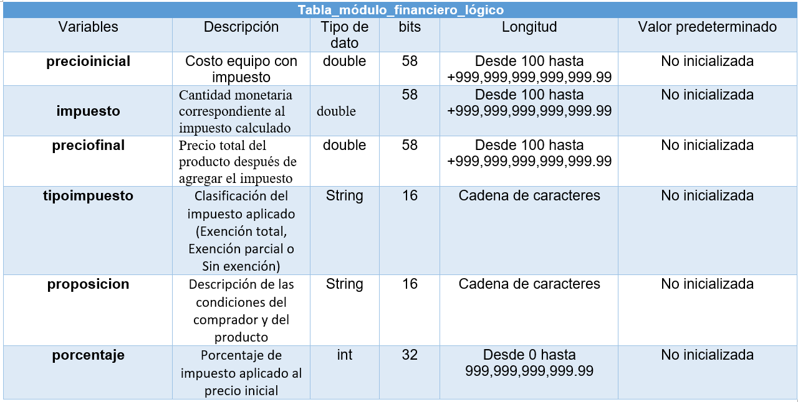
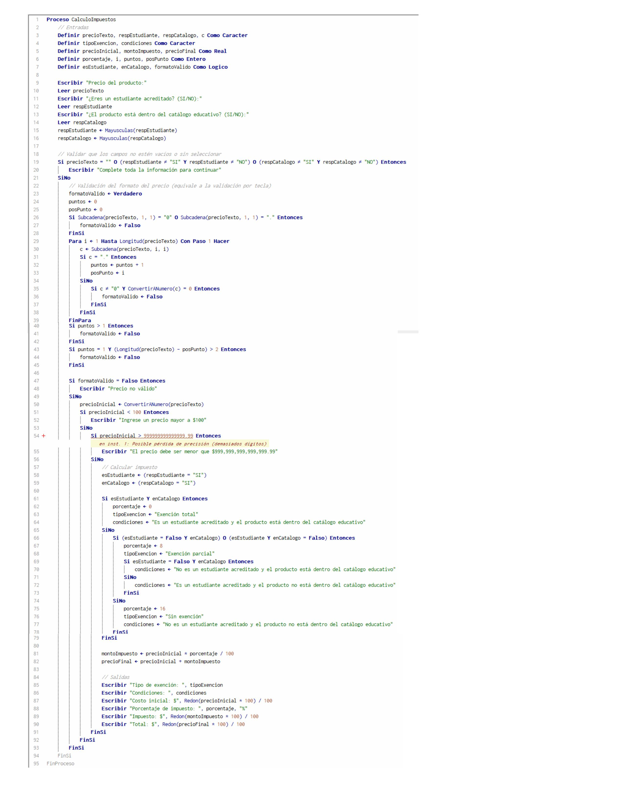
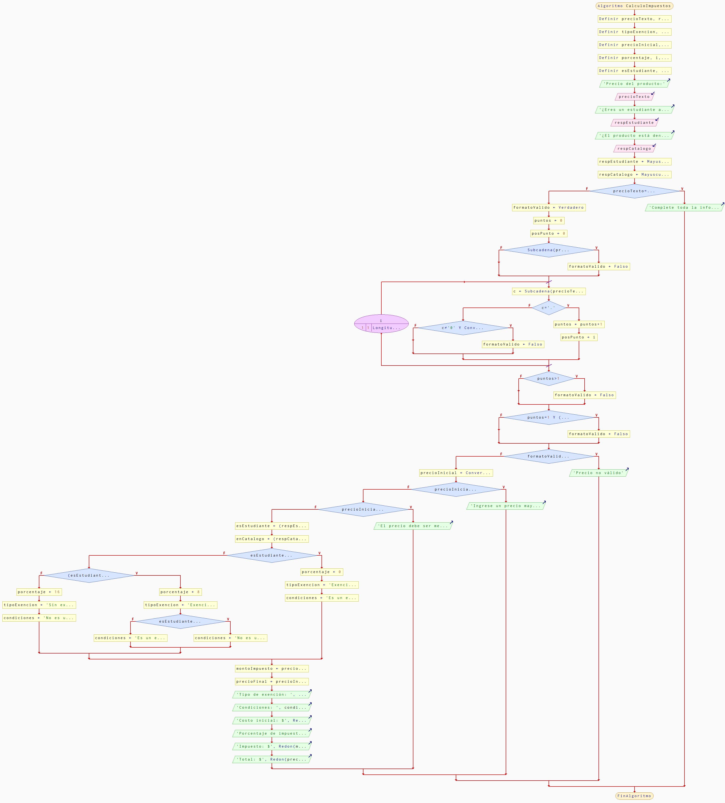

### Módulo de impuestos: exenciones por estudiante acreditado y catálogo educativo
ENUNCIADO:

En el contexto del comercio electrónico de tecnologías de la información, el costo final de adquisición de equipos informáticos está sujeto a políticas fiscales y esquemas de subsidio educativo. Se requiere diseñar la lógica de control para un módulo informático que determine de manera automatizada el porcentaje de impuesto (o exención) aplicable a un comprador.

### 1. Tabla detallada de entradas, procesos y salidas

| Entradas | Procesos (detallados) | Salidas |
|---|---|---|
| Precio, condición de estudiante y pertenencia al catálogo ingresados por el usuario. | 1. Captura de datos: Se recibe el precio mediante el campo PrecioT, la condición de estudiante mediante los botones SiErb y NoErb, y la pertenencia al catálogo educativo mediante SiPrb y NoCrb. | Valores de precio, condición de estudiante y pertenencia al catálogo capturados. |
| Texto del campo de precio. | 2. Validación de caracteres: En PrecioTKeyTyped se permite solo dígitos y un punto decimal. Se impide que el valor inicie con 0 o con punto, que se escriban varios puntos y que se capturen más de dos decimales. Además, PrecioT.setTransferHandler(null) evita pegar texto en el campo. | Campo de precio que solo acepta valores numéricos con formato válido. |
| Precio y selecciones de los botones. | 3. Validación de campos: Se comprueba mediante getText().trim().isEmpty() que el precio no esté vacío y mediante getSelection() == null que se haya elegido una opción en cada grupo de botones. Si falta algún dato, se asigna a mensaje el texto de error, se llama a cuadrodedialogo(mensaje) y después al método limpiar(). | Mensaje: Complete toda la información para continuar. |
| Precio ingresado. | 4. Validación del monto mínimo: Se compara Double.parseDouble(PrecioT.getText()) < 100. Si el precio es menor a 100, se muestra el error y se llama a limpiar(). | Mensaje: Ingrese un precio mayor a $100. |
| Precio ingresado. | 5. Validación del monto máximo: Se comprueba que el precio no sea mayor a 999999999999999.99. Si lo supera, se muestra el error y se llama a limpiar(). | Mensaje: El precio debe ser menor que $999,999,999,999,999.99. |
| Datos validados. | 6. Conversión y declaración de variables: Se declaran las variables double impuesto, precioinicial, preciofinal; String tipoImpuesto, proposicion; e int porcentaje. El texto del precio se convierte a número decimal mediante Double.parseDouble(). | Variables listas para realizar operaciones. |
| Estudiante = Sí y catálogo = Sí. | 7. Exención total: Se evalúa SiErb.isSelected() && SiPrb.isSelected(). Se asigna impuesto = precioinicial * 0, tipoImpuesto = Excención total, porcentaje = 0 y la proposición correspondiente. | Ley: Excención total. Condiciones evaluadas. Porcentaje: 0%. |
| Estudiante = No y catálogo = Sí, o estudiante = Sí y catálogo = No. | 8. Exención parcial: Se evalúa (NoErb.isSelected() && SiPrb.isSelected()) || (SiErb.isSelected() && NoCrb.isSelected()). Se asigna impuesto = precioinicial * 0.08, tipoImpuesto = Excención parcial y porcentaje = 8. Un if interno define la proposición según cuál de las dos condiciones se cumplió. | Ley: Excención parcial. Condiciones evaluadas. Porcentaje: 8%. |
| Estudiante = No y catálogo = No. | 9. Sin exención: Si no se cumple ninguna de las condiciones anteriores (else), se asigna impuesto = precioinicial * 0.16, tipoImpuesto = Sin excención y porcentaje = 16. | Ley: Sin excención. Condiciones evaluadas. Porcentaje: 16%. |
| Precio inicial e impuesto. | 10. Cálculo del precio total: Se realiza la suma preciofinal = precioinicial + impuesto. La variable preciofinal recibe el precio inicial más el impuesto calculado. | Precio total a pagar. |
| Valores calculados. | 11. Formateo de resultados: Se utiliza String.format($%,.2f, valor) para mostrar dos decimales, separar los miles con comas y evitar notación científica. Los textos se colocan en las etiquetas LeyR, CondicionesR, CostoiR, PorcentajeiR, ImpuestoR y TotalL. | Tipo de exención, condiciones, costo inicial, porcentaje, impuesto y total con dos decimales. |
| Resultados calculados. | 12. Visualización: Se ejecuta Resultados.setVisible(true) para mostrar el panel que contiene los resultados. | Panel de resultados visible en pantalla. |
| Acción del botón Limpiar. | 13. Limpieza de datos: Se asigna una cadena vacía al campo PrecioT, se ejecuta clearSelection() en EstudianteGrb y ProductoGrb, y Resultados.setVisible(false) oculta el panel. | Campos vacíos, botones sin selección y panel de resultados oculto. |

TABLA VARIABLES:

Imágen de autoría propia

### SOLUCIÓN:

Leer el precio del producto, la condición de estudiante acreditado (Sí o No) y la pertenencia del producto al catálogo educativo (Sí o No).

Validar que no falte ninguna información y que el precio esté dentro del rango permitido (mínimo $100 y máximo $999,999,999,999,999.99).

Determinar el tipo de exención y el porcentaje de impuesto según las condiciones:

- Estudiante acreditado y producto dentro del catálogo educativo: exención total (0 %).
- Estudiante acreditado y producto fuera del catálogo, o no estudiante y producto dentro del catálogo: exención parcial (8 %).
- No estudiante y producto fuera del catálogo: sin exención (16 %).

Calcular el impuesto: impuesto = precio inicial × porcentaje.

Calcular el precio total a pagar: total = precio inicial + impuesto.

Mostrar los resultados al usuario (ley aplicada, condiciones evaluadas, costo inicial, porcentaje de impuesto, impuesto aplicado y total).

ALGORITMO (PSEUDOCÓDIGO):

Imágen de autoría propia

DIAGRAMA DE FLUJO:

Imágen de autoría propia

### INSTRUCCIONES DESCARGAR PROGRAMA:
1. Asegúrate de tener instalado Java en tu ordenador. Usa: java --version en la terminal (version 11 en adelante).
2. Clonar el repositorio de github con el código del programa a tu computadora local (Link a github: https://github.com/Muunsitaw/proyecto-1a).
3. Navegar en la terminal hasta llegar a la carpeta "Impuestos". (Ruta: ~/proyecto-1a-revision-final/problemas/problema2/Impuestos)
4. Ejecutar el programa mediante el comando "./run.sh".

NOTA: Si tu sistema operativo muestra un error como el siguiente: "Permission denied" deberás ejecutar "chmod +x build.sh run.sh" para cambiar los permisos de los archivos en tu ordenador. Para más información: https://www.geeksforgeeks.org/linux-unix/what-does-chmod-x-do-and-how-to-use-it/ 

### INSTRUCCIONES USO PROGRAMA:
1. Seleccionar el "Módulo de impuestos" desde el menú principal del programa.
2. Una vez dentro de la interfaz, ingresar los siguientes campos: precio del producto, si el comprador es un estudiante acreditado (Sí o No) y si el producto está dentro del catálogo educativo (Sí o No). El programa en automático valida los datos de entrada: el campo de precio solo permite números y un punto decimal, no puede iniciar con 0 o con punto y admite máximo dos decimales. Si falta información o el precio está fuera del rango permitido, se mostrará una ventana emergente de error y se solicitará el reingreso. Si se desea reiniciar los datos de entrada y los resultados, se debe presionar el botón "Limpiar".
3. Presionar el botón "Calcular" para realizar el cálculo correspondiente y mostrar los resultados.
4. El usuario tiene la opción de continuar usando el módulo, salir al menú principal con el botón "Volver al menú" o salir del programa presionando "Salir".

EJEMPLO EJECUCIÓN:

Datos de entrada:

Precio del producto: $1000.00

¿Eres un estudiante acreditado?: Sí

¿El producto está dentro del catálogo educativo?: No

Datos de salida:

Ley: Excención parcial

Condiciones: Es un estudiante acreditado y el producto no está dentro del cátalogo educativo

Costo inicial: $1,000.00

Porcentaje de impuesto: 8%

Impuesto aplicado: $80.00

Total: $1,080.00

ENLACE A PRUEBAS:

[Ir a tabla de pruebas](pruebas/casos-prueba.md)